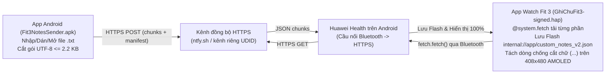

# 📘 Hướng Dẫn Toàn Tập: Setup, Phát Triển, Build & Cài App Cho Huawei Watch Fit 3

Tài liệu này ghi chép đầy đủ toàn bộ quá trình từ con số 0 đến khi hoàn thiện, đóng gói, ký chứng chỉ và cài đặt thành công hệ thống ứng dụng **Ghi Chú Fit 3** (gồm app đồng hồ `.hap` cho **Huawei Watch Fit 3** và app đồng bộ `.apk` cho **Android**), bao gồm tất cả các lỗi thực tế đã gặp và cách xử lý triệt để.

---

## 1. Tổng Quan Kiến Trúc & Thông Số Thiết Bị

### 1.1. Thông số màn hình & hệ điều hành Huawei Watch Fit 3
- **Loại thiết bị HarmonyOS:** `liteWearable` (chạy LiteOS + bộ máy giao diện ACELite + JavaScript engine **JerryScript**).
- **Màn hình:** AMOLED 1.82 inch, mặt chữ nhật bo góc cong 2.5D.
- **Độ phân giải gốc:** **408 px (rộng) × 480 px (cao)** — mật độ điểm ảnh ~347 PPI, độ sáng tối đa 1.500 nits.
- **Đặc điểm kỹ thuật quan trọng:**
  - Bộ nhớ RAM hạn chế, dùng file bytecode biên dịch sẵn (`.bc`) ở chế độ Release.
  - Không có trình duyệt độc lập và **không hỗ trợ `@system.bluetooth` (`undefined`)**.
  - Hỗ trợ mạng thông qua **`@system.fetch`** (đi qua cầu nối Bluetooth của ứng dụng **Huawei Health** trên điện thoại Android).

### 1.2. Kiến trúc hệ thống 2 ứng dụng



### 1.3. Cấu trúc thư mục dự án (`c:\personal_kyvu\CODE\build-app-fit3`)

```text
build-app-fit3/
├── entry/                                # Mã nguồn app Đồng hồ (HarmonyOS Lite Wearable)
│   └── src/main/
│       ├── config.json                   # Khai báo BundleName, deviceType, reqPermissions, pages
│       └── js/MainAbility/
│           ├── app.js                    # Điểm khởi chạy ứng dụng
│           ├── common/
│           │   ├── notes_data.js         # Ghi chú mặc định (tự sinh từ notes_txt/)
│           │   ├── notes_store.js        # Lưu trữ Flash (@system.file) + @system.storage
│           │   └── text_engine.js        # Bộ tách dòng theo bề rộng ký tự chống cắt chữ (...)
│           └── pages/
│               ├── index/                # Màn hình danh sách ghi chú (408x480)
│               ├── reader/               # Màn hình đọc toàn văn & phân trang 35 dòng/trang
│               └── sync/                 # Màn hình tải ghi chú từ điện thoại (@system.fetch)
├── android-sender/                       # Dự án Android Studio (App gửi ghi chú trên ĐT)
│   └── app/src/main/
│       ├── AndroidManifest.xml
│       └── java/com/kyvu/fit3notessender/MainActivity.java
├── notes_txt/                            # Thư mục chứa file .txt mặc định đóng gói kèm .hap
├── signing/                              # Toàn bộ chứng chỉ ký (.p12, .csr, .cer, .p7b, .jks)
├── sync-notes.ps1                        # Đồng bộ notes_txt/ -> notes_data.js
├── build-hap.ps1                         # Script 1-click build & ký GhiChuFit3-signed.hap
├── build-android-apk.ps1                 # Script 1-click build & ký Fit3NotesSender.apk
├── GhiChuFit3-signed.hap                 # Thành phẩm cài lên Huawei Watch Fit 3
└── Fit3NotesSender.apk                   # Thành phẩm cài lên điện thoại Android
```

---

## 2. Phần 1: Chuẩn Bị Môi Trường & Công Cụ (Setup)

### 2.1. Trên máy tính Windows
1. **Cài đặt DevEco Studio (bản 6.1.1 trở lên):**
   - Đường dẫn mặc định: `C:\Program Files\Huawei\DevEco Studio`
   - Đi kèm sẵn:
     - Node.js: `tools\node\node.exe`
     - Hvigor: `tools\hvigor\bin\hvigorw.js`
     - JBR (Java): `jbr\bin\java.exe`
     - JerryScript parser (kiểm tra cú pháp JS): `sdk\default\openharmony\js\build-tools\ace-loader\bin\jerry.exe`
     - Bộ công cụ đóng gói & ký Lite Wearable:
       - `sdk\default\openharmony\js\build-tools\binary-tools\haptobin_tool.jar`
       - `sdk\default\openharmony\toolchains\lib\app_packing_tool.jar`
       - `sdk\default\openharmony\toolchains\lib\hap-sign-tool.jar`
2. **Cài đặt Android Studio & Android SDK:**
   - JDK/JBR: `C:\Program Files\Android\Android Studio\jbr\bin` (`javac.exe`, `jar.exe`, `keytool.exe`)
   - Android Platform SDK: `C:\Users\<user>\AppData\Local\Android\Sdk\platforms\android-37.0\android.jar`
   - Android Build-Tools: `C:\Users\<user>\AppData\Local\Android\Sdk\build-tools\36.0.0` (`aapt2.exe`, `d8.bat`, `zipalign.exe`, `apksigner.bat`)

### 2.2. Trên điện thoại Android & đồng hồ Watch Fit 3
1. Cài **HUAWEI Health** và kết nối sẵn với **Huawei Watch Fit 3**.
2. Cài **HUAWEI DevEco Assistant** trên điện thoại Android để lấy UDID và nạp file `.hap` vào đồng hồ qua Bluetooth.
3. **Lấy UDID của đồng hồ:**
   - Mở **HUAWEI DevEco Assistant** trên điện thoại (đang ghép đôi với Fit 3) -> chọn **Wear Engine** / **Device Info** -> sao chép chuỗi **UDID** 64 ký tự hex của đồng hồ bạn.

---

## 3. Phần 2: Thiết Lập Chứng Chỉ Ký (Signing) Cho Watch Fit 3

Huawei Watch Fit 3 bắt buộc mọi file `.hap` cài vào máy thật phải được ký đúng **Debug Certificate (`.cer`)** và **Debug Profile (`.p7b`)** có chứa **UDID** của đồng hồ đó.

### Bước 1: Tạo Keystore (`.p12`) và yêu cầu chứng chỉ (`.csr`)
Chạy lệnh `keytool` (hoặc tạo trong DevEco Studio -> *Build -> Generate Key and CSR*):
- **Keystore:** `signing\fit3notes.p12`
- **Alias:** `fit3notes`
- **Thuật toán:** `EC` (256-bit) / ký `SHA256withECDSA`
- **CSR xuất ra:** `signing\fit3notes.csr`

### Bước 2: Xin `.cer` và `.p7b` trên AppGallery Connect (AGC)
1. Truy cập [AppGallery Connect](https://developer.huawei.com/consumer/en/service/josp/agc/index.html) -> **Users and permissions -> Device management** -> Thêm thiết bị mới với **UDID** của Watch Fit 3.
2. Vào **Certificate management** -> Tạo mới **Debug Certificate**, upload file `signing\fit3notes.csr` -> tải về file `.cer` (ví dụ lưu thành `signing\debug_cert.cer`).
3. Vào **My projects** -> Tạo project & thêm ứng dụng HarmonyOS có **Package/Bundle Name** trùng khớp 100% (`com.kyvu.fit3notes`).
4. Vào **HAP Provision Profile management** -> Tạo **Debug Profile**, chọn đúng Certificate vừa tạo và tick chọn thiết bị Watch Fit 3 -> tải về file `.p7b` (ví dụ lưu thành `signing\debug_profile.p7b`).
5. Đặt toàn bộ các file chứng chỉ vào thư mục `signing\`, sau đó sao chép `.env.example` thành `.env` và điền đúng tên file chứng chỉ, mật khẩu keystore và tên kênh đồng bộ bí mật (`SYNC_CHANNEL_PREFIX`) của bạn. *(File `.env` và thư mục `signing/` đã được `.gitignore` chặn tuyệt đối để an toàn khi đẩy repo Public.)*

---

## 4. Phần 3: Các Quy Tắc Bắt Buộc Khi Code App Cho Watch Fit 3

Đây là những bài học rút ra từ quá trình test trực tiếp trên Previewer và đồng hồ thật — chỉ cần vi phạm 1 điều là app sẽ bị đen màn hình hoặc lỗi cài đặt:

### 4.1. Tuyệt đối KHÔNG dùng Regular Expression (`/.../`) trong JavaScript
- **Nguyên nhân:** JerryScript trên Lite Wearable tắt hoàn toàn module RegExp. Chỉ cần xuất hiện 1 biểu thức như `/\r\n/g` hay `/\s+/g` là toàn bộ trang sẽ chết với lỗi `SyntaxError: Regexp is not supported in the selected profile` và **màn hình đồng hồ đen thui**.
- **Cách thay thế:** Luôn dùng `.split(...).join(...)`, `.indexOf(...)`, và vòng lặp `for` kiểm tra từng ký tự `charAt(i)`.
- **Cách kiểm tra cú pháp chuẩn xác trước khi cài:**
  ```powershell
  $jerry = "C:\Program Files\Huawei\DevEco Studio\sdk\default\openharmony\js\build-tools\ace-loader\bin\jerry.exe"
  Get-ChildItem "entry\build\default\intermediates\lite_source\default\assets\js\MainAbility" -Recurse -Filter "*.js" | ForEach-Object {
      & $jerry --parse-only $_.FullName
      Write-Output "$($_.Name) -> exit=$LASTEXITCODE"
  }
  ```
  *(Mọi file phải trả về `exit=0`.)*

### 4.2. Quy tắc CSS & Giao diện trên màn hình AMOLED 408 × 480 px (2.5D)
- **Selector:** ACELite chỉ hỗ trợ 1 class đơn (`.note-card`). Không dùng bộ chọn lồng nhau (`.card .title`), không dùng pseudo-class (`:active`).
- **Kích thước & Màu sắc:** Mọi phần tử nên có `width` và `height` tính bằng `px` tường minh; mã màu dùng đủ 6 ký tự `#RRGGBB`.
- **Chuẩn màn hình Fit 3:**
  - Khung gốc `.page-root`, `.reader-root`, `.sync-root` và `<list>` đặt đúng **`width: 408px; height: 480px;`**.
  - Nền dùng đen thuần **`#000000`** tối ưu cho tấm nền AMOLED 1.500 nits.
  - Luôn thêm `<list-item>` khoảng đệm an toàn phía trên (`height: 16px`) và phía dưới (`height: 48px–52px`) để nội dung cuối cùng không bị che mất tại 4 góc bo cong kính 2.5D.
- **Kỹ thuật hiển thị văn bản không giới hạn, không cắt chữ (`...`):**
  - Không dồn cả đoạn văn dài vào 1 thẻ `<text>` (ACELite sẽ cắt cụt bằng `...`).
  - Dùng `text_engine.js` đo bề rộng tỷ lệ từng ký tự (ký tự hẹp `i,l,1` = `0.42`, chữ thường = `0.62`, tiếng Việt có dấu = `0.65`, chữ hoa rộng `M,W,Đ` = `0.96`) để cắt sẵn từng dòng vừa khít chiều rộng `368px`.
  - Render **1 dòng = 1 `<list-item>`** và phân trang **35 dòng / trang** để RAM JerryScript luôn mượt dù ghi chú dài hàng chục nghìn chữ.

### 4.3. Lưu ý đặc thù về Mạng (`@system.fetch`) & Quyền (`config.json`)
- `@system.bluetooth` **không có** trên Watch Fit 3 (`undefined`).
- `@system.fetch` **hoạt động ổn định** qua Huawei Health với 4 quy tắc:
  1. Phải khai báo quyền `ohos.permission.INTERNET` trong `config.json` kèm đầy đủ `reason` và `usedScene` (tránh lỗi 46 khi cài):
     ```json
     "reqPermissions": [
       {
         "name": "ohos.permission.INTERNET",
         "reason": "Sync notes from phone",
         "usedScene": {
           "ability": [".MainAbility"],
           "when": "inuse"
         }
       }
     ]
     ```
  2. Chỉ dùng **`https://`** (URL `http://127.0.0.1` sẽ bị chặn trả mã lỗi `-6`).
  3. Mỗi gói phản hồi HTTP phải giữ **dưới ~4–5 KB** (giới hạn buffer cầu nối của LiteOS khoảng 7 KB). Vì vậy app chia ghi chú thành các phần **2.200 bytes UTF-8**.
  4. **Chỉ mở 1 phiên `fetch` tại một thời điểm:** Tuyệt đối không gọi `fetch.fetch()` mới ngay bên trong `success()` của lượt trước (sẽ báo lỗi **`-9`**). Bắt buộc lưu hàm tiếp theo rồi gọi trong `complete()` sau độ trễ `setTimeout(..., 500)`.

---

## 5. Phần 4: Quy Trình Build & Ký File `.hap` (Khắc Phục Lỗi Error 40)

### Vì sao build mặc định từ DevEco Studio 6.1 cài lên Watch Fit 3 bị `Installation failed: 40`?
DevEco Studio 6.1 tự động chèn các trường mới vào `config.json` (`apiVersion.compatible = 60101024`, `appEnvironments`, `mainAbility`, `package`, `debug: true`), đồng thời ở chế độ Debug không tạo file bytecode `.bc` và không tạo `icon.bin`. Bộ phân tích gói trên firmware Watch Fit 3 (`gt_bundle_parser.cpp`) sẽ từ chối ngay với **Error 40 (Invalid configuration file format)**.

### Cách xử lý đã tự động hóa 100% trong `build-hap.ps1`
Script `build-hap.ps1` thực hiện tuần tự 4 bước chuẩn xác:
1. Chạy `sync-notes.ps1` để gom mọi file `.txt` trong `notes_txt/` vào `notes_data.js`.
2. Biên dịch ở chế độ **Release** bằng Hvigor (`hvigorw.js assembleHap -p buildMode=release --no-daemon`) để tạo đủ bytecode `.bc` cho JerryScript (`app.bc`, `index.bc`, `reader.bc`, `sync.bc`).
3. **Chuẩn hóa `entry\build\default\intermediates\lite_source\default\config.json`**:
   - Ép `app.apiVersion` về chuẩn tương thích Fit 3: `compatible: 4, target: 6, releaseType: "Release"`.
   - Loại bỏ toàn bộ các trường thừa của DevEco 6.1.
   - Sao chép `icon.png.bin -> icon.bin`, `icon_small.png.bin -> icon_small.bin` và xóa các file `.map`.
4. **Đóng gói & Ký 2 lớp (`.bin` và `.hap`)**:
   - Đóng gói `.bin`: `haptobin_tool.jar`
   - Ký `.bin`: `hap-sign-tool.jar` (`-inForm bin -signAlg SHA256withECDSA`)
   - Đóng gói `.hap`: `app_packing_tool.jar` (`--mode hap`)
   - Ký `.hap`: `hap-sign-tool.jar` (`-inForm zip -signAlg SHA256withECDSA`)
   - Xuất file thành phẩm ra gốc dự án: **`GhiChuFit3-signed.hap`**.

### Lệnh chạy build 1-click cho Watch Fit 3
Mở PowerShell tại `c:\personal_kyvu\CODE\build-app-fit3` và chạy:
```powershell
powershell -ExecutionPolicy Bypass -File ".\build-hap.ps1"
```
*(Lưu ý PowerShell: Khi truyền `-Dfile.encoding=UTF-8` cho Java trong PowerShell, bắt buộc bọc trong dấu ngoặc kép `"-Dfile.encoding=UTF-8"` để tránh lỗi `ClassNotFoundException`.)*

---

## 6. Phần 5: Quy Trình Build App Android Companion (`Fit3NotesSender.apk`)

App Android được viết thuần Java (`android.widget.*` + `HttpURLConnection`, không kéo thư viện nặng) nên biên dịch chỉ mất ~5 giây và file `.apk` nhẹ ~25 KB.

### 6.1. Cơ chế hoạt động của `MainActivity.java`
- Hỗ trợ nhập trực tiếp, **Dán Clipboard**, **Mở file `.txt`** từ bộ nhớ điện thoại, tự lưu nháp và lưu lịch sử 10 ghi chú gần nhất.
- Cắt văn bản dài theo **UTF-8 codePoint** (`<= 2.200 bytes/phần`) để không bao giờ cắt đôi ký tự tiếng Việt có dấu.
- Với ghi chú ngắn (`<= 1.500 bytes`), nhúng thẳng nội dung (`"c"`) vào manifest để đồng hồ tải hoàn tất chỉ trong **1 lượt duy nhất (~0.5 giây)**.
- Kênh đồng bộ riêng đọc từ biến `SYNC_CHANNEL_PREFIX` trong file `.env` (tự động sinh `SyncConfig.java` và `sync_config.js` khi chạy script build, nên cả 2 ứng dụng luôn khớp kênh tự động mà không lộ tên kênh lên Git).

### 6.2. Lệnh chạy build 1-click cho Android APK
Script `build-android-apk.ps1` tự động chạy chuỗi công cụ Android SDK:
1. `aapt2.exe compile` + `aapt2.exe link` (biên dịch tài nguyên & `AndroidManifest.xml`).
2. `javac.exe --release 8 -encoding UTF-8` (biên dịch `R.java` và `MainActivity.java`).
3. `d8.bat --min-api 26` (chuyển `.class` sang `classes.dex`).
4. `jar.exe -uf` (đóng gói `classes.dex` vào APK) + `zipalign.exe -f -p 4`.
5. `apksigner.bat sign` (ký bằng `signing\android-sender.jks`, hỗ trợ v2 + v3) và `apksigner verify`.

Chạy trong PowerShell:
```powershell
powershell -ExecutionPolicy Bypass -File ".\build-android-apk.ps1"
```
Thành phẩm xuất ra: **`Fit3NotesSender.apk`**. *(Bạn cũng có thể mở thư mục `android-sender/` trực tiếp bằng Android Studio nếu muốn chỉnh sửa trực quan.)*

---

## 7. Phần 6: Cài Đặt Lên Thiết Bị & Sử Dụng Hàng Ngày

### 7.1. Cài đặt lần đầu (chỉ cần làm 1 lần)
1. **Lên Điện thoại Android:** Copy file `Fit3NotesSender.apk` sang điện thoại và bấm cài đặt.
2. **Lên Đồng hồ Watch Fit 3:**
   - Copy file `GhiChuFit3-signed.hap` sang điện thoại (thư mục `Downloads` hoặc thư mục `haps`).
   - Đảm bảo đồng hồ đang kết nối với **HUAWEI Health**.
   - Mở **HUAWEI DevEco Assistant** -> **App Management** -> chọn file `GhiChuFit3-signed.hap` -> bấm **Install**.

### 7.2. Thêm & đọc ghi chú mới hàng ngày (không cần đụng máy tính)
1. Trên điện thoại, mở **Ghi Chú Fit 3** -> gõ, dán hoặc chọn file `.txt` -> bấm **`[GỬI GHI CHÚ SANG WATCH FIT 3]`**.
2. Trên đồng hồ Watch Fit 3, mở **Ghi Chú Fit 3** -> bấm **`[↓ Nhận từ ĐT]`** -> đồng hồ tự tải về 100%, rung nhẹ và lưu vĩnh viễn vào bộ nhớ Flash -> bấm **`Đọc ngay »`**.
3. Trong màn hình đọc: dùng `A-` / `A+` để đổi 3 cỡ chữ (`23px` / `27px` / `31px`), dùng `« Trước` / `Sau »` và `Đầu / -5 / +5 / Cuối` để lật trang; đồng hồ tự nhớ vị trí trang đang đọc.

---

## 8. Phần 7: Bảng Tổng Hợp Lỗi Thực Tế & Cách Khắc Phục

| Triệu chứng / Mã lỗi | Nguyên nhân gốc rễ | Cách xử lý chuẩn |
|---|---|---|
| **Màn hình đồng hồ đen thui** khi mở app hoặc Previewer | Có biểu thức Regex (`/.../`) trong file `.js` -> JerryScript báo `SyntaxError` | Xóa sạch Regex, thay bằng `.split().join()` và kiểm tra bằng `jerry.exe --parse-only` |
| **`Installation failed: 40`** *(Invalid configuration file format)* | `config.json` dính `apiVersion` 60101024 của DevEco 6.1, thiếu `.bc` hoặc thiếu `icon.bin` | Luôn build qua `build-hap.ps1` (build Release `.bc` + ép API `4..6` + tạo `icon.bin`) |
| **`Installation failed: 46`** | Khai báo `reqPermissions` trong `config.json` nhưng thiếu `reason` hoặc `usedScene` | Luôn ghi đủ `name`, `reason`, `usedScene.ability`, `usedScene.when` |
| **`Cannot read property 'startBLEScan' of undefined`** | Firmware Watch Fit 3 không có module `@system.bluetooth` | Không dùng BLE scan trên Fit 3; chuyển sang `@system.fetch` qua Huawei Health |
| **`@system.fetch` báo lỗi `-6`** | Dùng URL `http://` (cleartext) hoặc `127.0.0.1`, hoặc điện thoại mất kết nối Huawei Health | Bắt buộc dùng URL `https://` hợp lệ và đảm bảo Huawei Health đang kết nối đồng hồ |
| **`@system.fetch` báo lỗi `-9`** | Gọi lượt `fetch.fetch()` thứ 2 ngay bên trong `success()` khi socket cũ chưa nhả | Chỉ gọi lượt `fetch` tiếp theo bên trong `complete()` + `setTimeout(..., 500)` và thêm retry |
| **Chữ/nút ở đáy bị khuyết 2 góc** | Dùng kích thước `454×454` (mặt tròn) và thiếu khoảng đệm góc cong 2.5D | Dùng đúng `width: 408px; height: 480px` + thêm `safe-top` (`16px`) và `safe-bottom` (`48–52px`) |
| **PowerShell báo `ClassNotFoundException: /encoding=UTF-8`** | Tham số `-Dfile.encoding=UTF-8` không được bọc ngoặc kép trong PowerShell | Bọc thành `"-Dfile.encoding=UTF-8"` |
