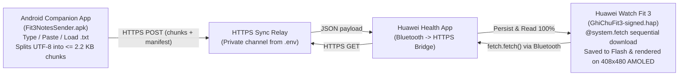

# Fit3 Notes — Full-Text Notes Reader & Phone Sync for Huawei Watch Fit 3

A lightweight, full-text note reader built specifically for the **Huawei Watch Fit 3** (`liteWearable` / HarmonyOS LiteOS) paired with an ultra-lightweight **Android Companion App** (`~25 KB` APK) for instant phone-to-watch syncing.

Designed to display **100% of any note — even thousands of words — without ever clipping or truncating text (`...`)** on the Fit 3's **1.82" 408 × 480 px 2.5D curved AMOLED display**.

---

## ✨ Key Features

- **Zero Text Truncation (Proportional Line-Wrapping Engine):**
  - Measures proportional character widths (narrow letters, uppercase/wide characters, Vietnamese diacritics, numbers, and unbroken long words/URLs) and wraps both titles and body text cleanly inside the `368 px` reading column.
  - Renders **1 line = 1 `<list-item>`** with smooth **35 lines/page** pagination, quick page jumps (`First / -5 / +5 / Last`), and automatic reading bookmark persistence (`@system.storage`).
- **Tuned 1:1 for Huawei Watch Fit 3 AMOLED (408 × 480 px, 347 PPI, 1,500 nits):**
  - Native `408 × 480 px` layout with top (`16 px`) and bottom (`48–52 px`) safe spacers so text and buttons never clip at the rounded 2.5D bezel corners.
  - Pure `#000000` AMOLED black background for maximum contrast and battery life, paired with soft `#F2F6FA` body text and 3 live font sizes (**Small `23px`**, **Medium `27px`**, **Large `31px`**).
- **Wireless Phone-to-Watch Note Sync (No Rebuild Needed):**
  - Type, paste from clipboard, or load any `.txt` file on the **Android Companion App** (`android-sender/`) and send it to your watch in 1–2 seconds.
  - Automatically splits long UTF-8 notes into safe `2.2 KB` chunks (staying well within LiteOS's `~7 KB` `@system.fetch` buffer limit) and embeds short notes (`<= 1.5 KB`) directly in the manifest for single-request instant download.
  - Persists synced notes permanently to watch flash storage (`internal://app/custom_notes_v2.json` via `@system.file`).
- **Safe for Public Repositories (`.env` Secret Isolation):**
  - All signing credentials, keystore paths, passwords, and private sync channel IDs are loaded from a git-ignored `.env` file at build time.

---

## 🏗️ Architecture



---

## 📁 Project Structure

```text
build-app-fit3/
├── entry/                                      # HarmonyOS Lite Wearable watch app (ACELite JS)
│   └── src/main/
│       ├── config.json                         # Bundle config, INTERNET permission, pages
│       └── js/MainAbility/
│           ├── app.js
│           ├── common/
│           │   ├── notes_data.js               # Built-in notes generated from notes_txt/
│           │   ├── notes_store.js              # Flash (@system.file) + @system.storage store
│           │   ├── sync_config.example.js      # Template (sync_config.js is auto-generated from .env)
│           │   └── text_engine.js              # Anti-truncation proportional line-wrapping engine
│           └── pages/
│               ├── index/                      # Home screen (408x480 AMOLED)
│               ├── reader/                     # Full-text paginated reader (35 lines/page)
│               └── sync/                       # Phone sync receiver (@system.fetch)
├── android-sender/                             # Android companion app (pure Android SDK Java)
│   └── app/src/main/
│       ├── AndroidManifest.xml
│       └── java/com/kyvu/fit3notessender/
│           ├── MainActivity.java
│           └── SyncConfig.java.example         # Template (SyncConfig.java is auto-generated from .env)
├── notes_txt/                                  # Optional default .txt notes bundled into the .hap
├── .env.example                                # Environment template (copy to .env)
├── sync-notes.ps1                              # Converts notes_txt/*.txt -> notes_data.js
├── build-hap.ps1                               # 1-click Release build, API 4-6 normalization & signing (.hap)
├── build-android-apk.ps1                       # 1-click CLI build & v2/v3 signing (.apk)
└── HUONG_DAN_BUILD_APP_FIT3.md                 # Detailed Vietnamese setup & troubleshooting handbook
```

---

## 🛠️ Prerequisites

1. **Windows PC** with:
   - **HUAWEI DevEco Studio 6.1+** (provides Hvigor, OpenHarmony SDK, `jerry.exe`, `haptobin_tool.jar`, `app_packing_tool.jar`, `hap-sign-tool.jar`).
   - **Android Studio / Android SDK** (provides JDK/JBR, `aapt2`, `d8`, `zipalign`, `apksigner`).
2. **Android Smartphone** paired with your **Huawei Watch Fit 3** via **HUAWEI Health**, plus **HUAWEI DevEco Assistant** installed for sideloading `.hap` packages.
3. **Huawei Developer Signing Files** (for installing on a physical Watch Fit 3):
   - Obtain your watch's 64-character **UDID** from **HUAWEI DevEco Assistant**.
   - Generate an EC (`SHA256withECDSA`) `.p12` keystore and `.csr`.
   - Register the watch UDID in **AppGallery Connect**, issue a **Debug Certificate (`.cer`)** and **Debug Provision Profile (`.p7b`)** for bundle `com.kyvu.fit3notes`, and place them inside a local `signing/` folder (ignored by Git).

---

## ⚙️ Configuration (`.env`)

1. Copy `.env.example` to `.env`:
   ```powershell
   Copy-Item .env.example .env
   ```
2. Edit `.env` with your own private sync channel and signing details:
   ```dotenv
   SYNC_CHANNEL_PREFIX=f3n_your_private_channel_id

   WATCH_KEYSTORE_FILE=signing/fit3notes.p12
   WATCH_CERT_FILE=signing/your_debug_cert.cer
   WATCH_PROFILE_FILE=signing/your_debug_profile.p7b
   WATCH_KEY_ALIAS=fit3notes
   WATCH_KEYSTORE_PASSWORD=your_keystore_password
   WATCH_KEY_PASSWORD=your_key_password

   ANDROID_KEYSTORE_FILE=signing/android-sender.jks
   ANDROID_KEY_ALIAS=fit3sender
   ANDROID_KEYSTORE_PASSWORD=your_android_keystore_password
   ANDROID_KEY_PASSWORD=your_android_key_password
   ```
   > **Security note:** `.env`, `signing/`, `sync_config.js`, `SyncConfig.java`, `*.hap`, and `*.apk` are all excluded by `.gitignore`.

---

## 🚀 Building & Installing

### 1. Build the Watch Fit 3 App (`.hap`)
```powershell
powershell -ExecutionPolicy Bypass -File ".\build-hap.ps1"
```
This script automatically:
1. Generates `sync_config.js` from `.env` and syncs any `.txt` files from `notes_txt/`.
2. Compiles Release bytecode (`.bc`) via Hvigor.
3. Normalizes `config.json` to `apiVersion` `4–6` and generates `icon.bin` / `icon_small.bin` (preventing **Error 40** on Watch Fit 3 firmware when building with DevEco Studio 6.1).
4. Packs and signs both `.bin` and `.hap` -> outputs **`GhiChuFit3-signed.hap`**.

*(Optional)* Verify zero JerryScript syntax/regex errors before sideloading:
```powershell
$jerry = "C:\Program Files\Huawei\DevEco Studio\sdk\default\openharmony\js\build-tools\ace-loader\bin\jerry.exe"
Get-ChildItem "entry\build\default\intermediates\lite_source\default\assets\js\MainAbility" -Recurse -Filter "*.js" | ForEach-Object {
    & $jerry --parse-only $_.FullName
    Write-Output "$($_.Name) -> exit=$LASTEXITCODE"
}
```

### 2. Build the Android Companion App (`.apk`)
```powershell
powershell -ExecutionPolicy Bypass -File ".\build-android-apk.ps1"
```
This compiles `SyncConfig.java` (generated from `.env`) + `MainActivity.java` directly via Android SDK CLI tools (`aapt2` -> `javac` -> `d8` -> `zipalign` -> `apksigner`) and outputs **`Fit3NotesSender.apk`**.  
*(You can also open `android-sender/` directly in Android Studio.)*

### 3. Sideload onto Devices
- **Android Phone:** Transfer and install `Fit3NotesSender.apk`.
- **Huawei Watch Fit 3:** Transfer `GhiChuFit3-signed.hap` to your Android phone, ensure the watch is connected in **HUAWEI Health**, open **HUAWEI DevEco Assistant -> App Management**, and install `GhiChuFit3-signed.hap`.

---

## 📲 Daily Usage

1. Open **Ghi Chú Fit 3** on your Android phone, enter/paste text or pick a `.txt` file, and tap **Send to Watch Fit 3**.
2. Open **Ghi Chú Fit 3** on your Watch Fit 3 and tap **`↓ Nhận từ ĐT`**.
3. The watch downloads all chunks over Huawei Health's HTTPS bridge, vibrates at `100%`, saves the note permanently to flash memory, and opens it directly in the anti-truncation reader.

---

## 🧠 Huawei Watch Fit 3 (`liteWearable`) Engineering Notes

Key hardware/firmware constraints discovered and solved during development:

| Issue / Error | Root Cause on Watch Fit 3 | Implemented Solution |
|---|---|---|
| **Black screen on launch / Previewer** | JerryScript on Lite Wearable disables RegExp (`/.../`), throwing `SyntaxError`. | Zero regex literals across the entire watch codebase; verified with `jerry.exe --parse-only`. |
| **`Installation failed: 40`** | DevEco 6.1 injects `apiVersion: 60101024` and extra fields into `config.json`; debug builds lack `.bc` snapshots and `icon.bin`. | `build-hap.ps1` compiles in `release` mode, normalizes `config.json` to API `4–6`, copies `icon.bin`, and repacks/signs `.bin` + `.hap`. |
| **`Installation failed: 46`** | `reqPermissions` missing `reason` or `usedScene`. | Declares `ohos.permission.INTERNET` with full `reason` and `usedScene` (`ability: [".MainAbility"]`, `when: "inuse"`). |
| **`@system.bluetooth` is `undefined`** | Watch Fit 3 LiteOS omits the `@system.bluetooth` JS module. | Switched sync transport to `@system.fetch` over Huawei Health's Bluetooth-to-HTTPS bridge. |
| **`@system.fetch` error `-6` / `-9`** | `-6`: cleartext `http://` or `127.0.0.1` blocked. `-9`: starting a 2nd `fetch` inside `success()` before LiteOS frees the single socket handle. | Uses HTTPS exclusively, chunks responses to `<= 2.2 KB`, waits for `complete()` + `500 ms` cooldown before the next chunk, and auto-retries up to 3 times. |

---

## 📄 License

Personal / educational open-source project. Feel free to fork and adapt for your own Huawei Lite Wearable devices!
